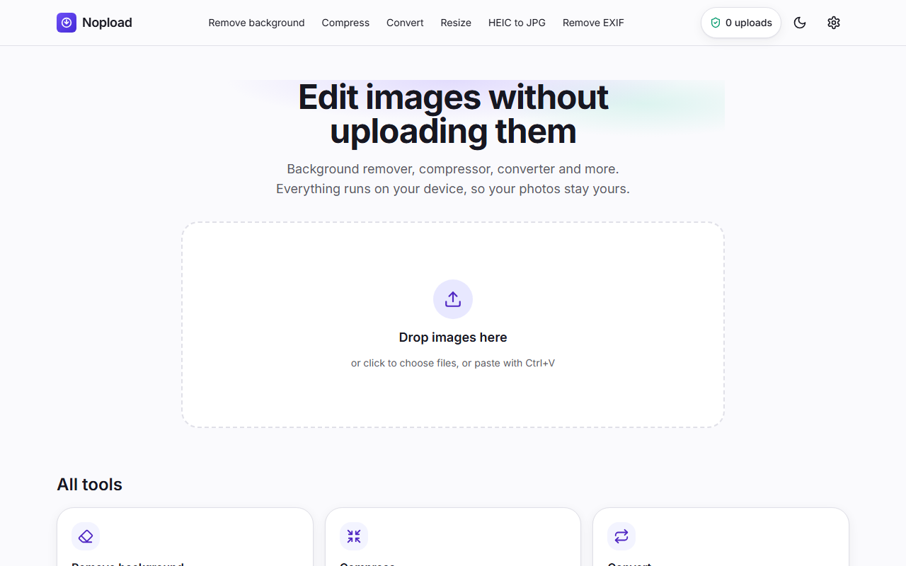
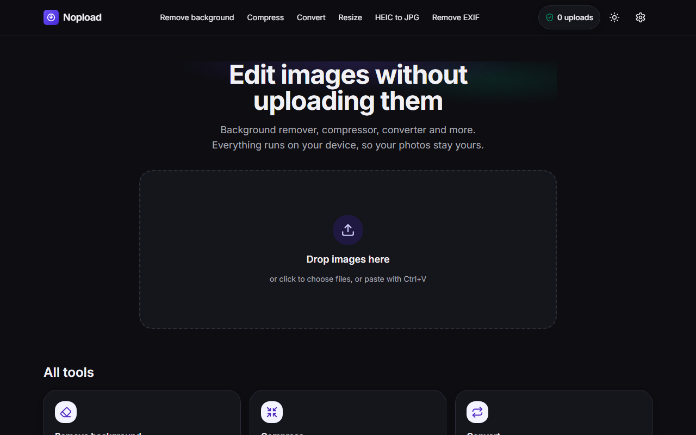
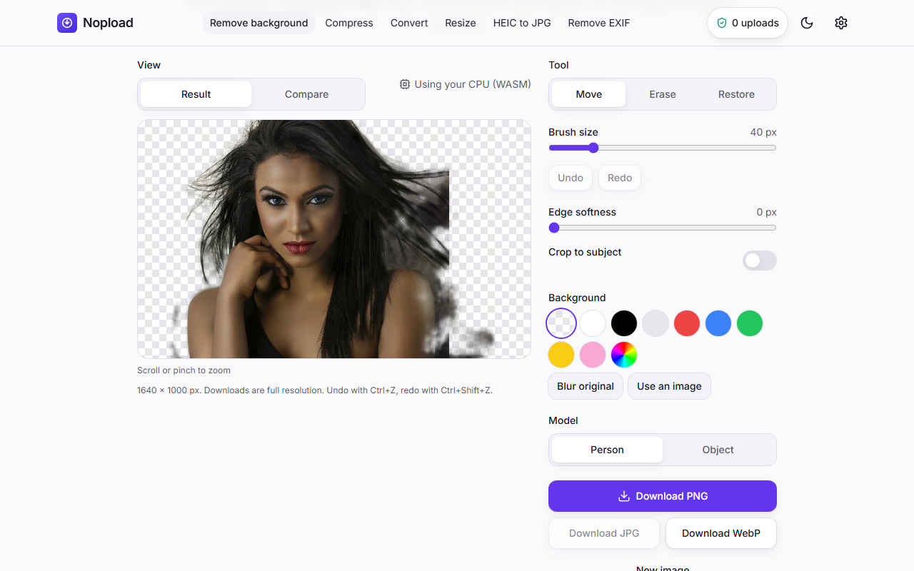
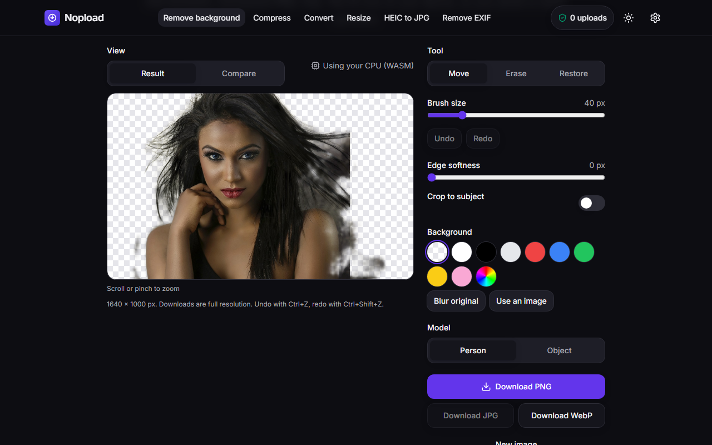
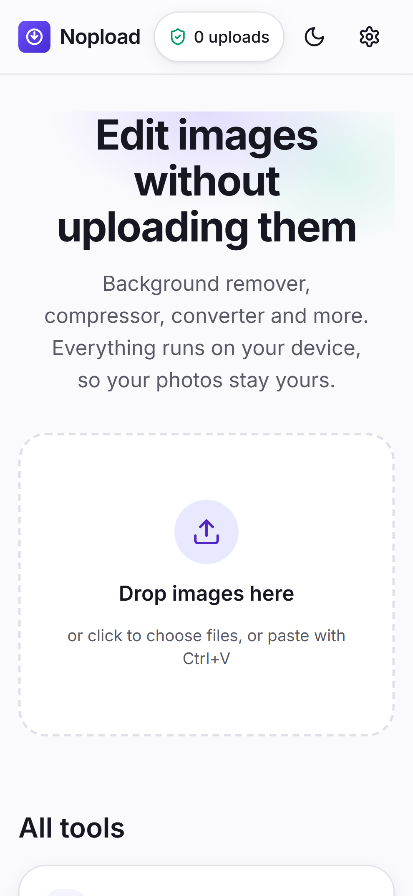
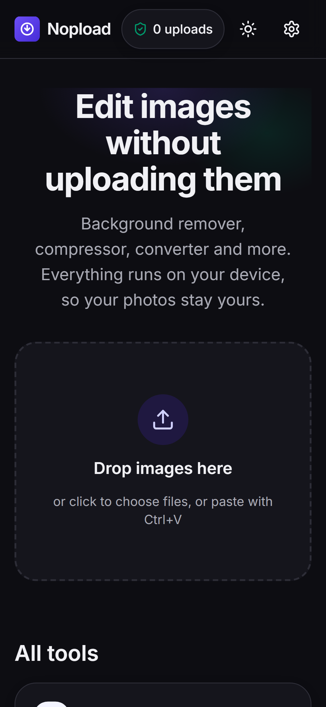
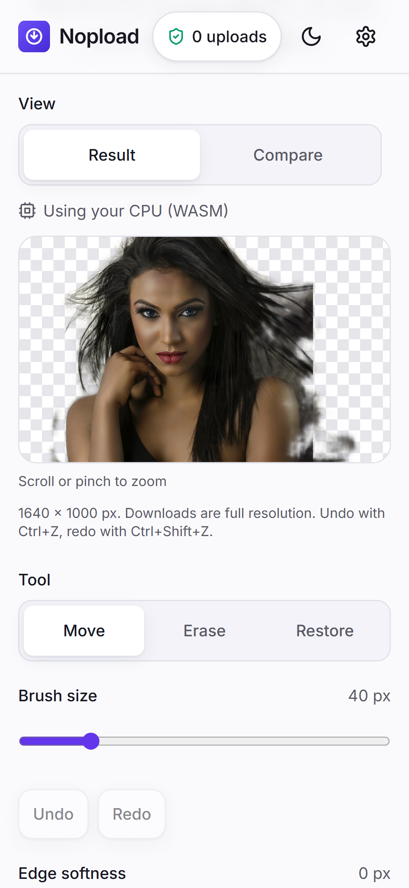
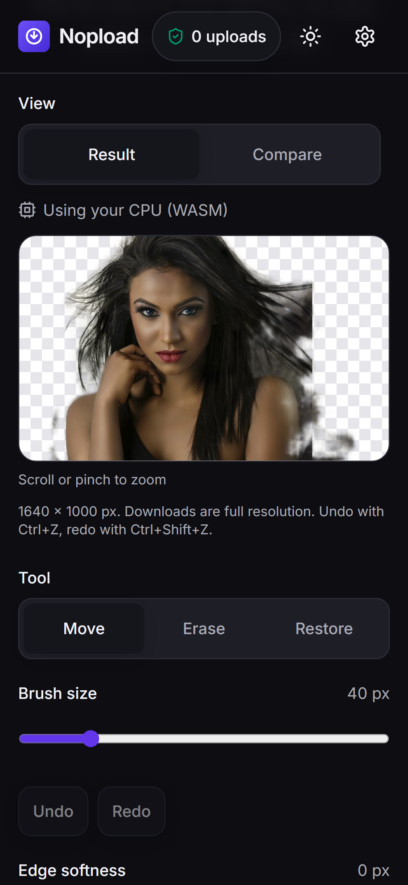

# Nopload

Edit images without uploading them: a free, ad-free image suite where every byte is processed in your browser.

| Light | Dark |
| --- | --- |
|  |  |
|  |  |

<p>
  
  
  
  
</p>

## Features

- **Remove background** (`/remove-background`): cut out people and objects at full resolution, as a transparent PNG. Erase/restore brush with undo, edge softness, crop to subject, solid colour, blurred or image backgrounds, and batches downloaded as a ZIP. It runs on WebGPU when available and falls back to WASM on the CPU.
- **remove.bg alternative** (`/remove-bg-alternative`) and **Remove background, no account** (`/remove-background-without-account`): the same tool, with no signup, no credits and no limits.
- **Compress** (`/compress-image`): make JPG, PNG and WebP files smaller in bulk (MozJPEG, OxiPNG).
- **Convert** (`/convert-image`): switch between JPG, PNG, WebP, AVIF and JXL.
- **Resize** (`/resize-image`): change dimensions or crop to a ratio, in bulk.
- **HEIC to JPG** (`/heic-to-jpg`): open iPhone photos anywhere, as JPG or PNG.
- **Remove EXIF** (`/remove-exif`): strip GPS location and camera data without re-encoding the image.
- **Drop anywhere on the home page**: Nopload asks what to do with the files and hands them to the chosen tool. Every result offers a next step (for example "Next: compress it").
- Works offline after the first visit (installable PWA), keyboard accessible, with light and dark themes.

## How privacy is verifiable

You do not have to take our word for it.

1. **The browser enforces it.** Every page is served with `Content-Security-Policy: ... connect-src 'self'` (see [`public/_headers`](public/_headers)). The page cannot send your images to any other origin, even if it tried.
2. **The "0 uploads" badge** in the header opens a panel that lists every network request the page has made, with a count of third-party requests (always 0).
3. **DevTools.** Open the Network tab, drop an image and watch: the only requests are the app's own files (the page, scripts, codecs and the model from `/models/`). No request carries your image.
4. **Offline.** Load a tool once, turn off your network and use it. It still works, because nothing needs a server.
5. **Automated tests.** The e2e suite fails if any request leaves the site's own origin on any page (`tests/e2e/privacy.spec.ts`), during model load and inference (`tests/e2e/remove-background.spec.ts`, E2.5), or offline (`tests/e2e/pwa.spec.ts`). `tests/e2e/handoff-privacy.spec.ts` checks that files handed between tools are deleted from IndexedDB on pickup.

## Stack

- [Astro 7](https://astro.build) (static, prerendered pages) with [Preact](https://preactjs.com) islands and [Tailwind CSS 4](https://tailwindcss.com)
- [onnxruntime-web](https://onnxruntime.ai) running MODNet and U2-Net-P (pinned in [`models.lock.json`](models.lock.json)) on WebGPU or WASM
- [jSquash](https://github.com/jamsinclair/jSquash) codecs (MozJPEG, OxiPNG, WebP, AVIF, JXL) and [libheif-js](https://github.com/catdad-experiments/libheif-js) for HEIC
- [exifr](https://github.com/MikeKovarik/exifr) for metadata, [fflate](https://github.com/101arrowz/fflate) for ZIPs
- [Comlink](https://github.com/GoogleChromeLabs/comlink) Web Workers, [Workbox](https://developer.chrome.com/docs/workbox) service worker
- Vitest and Playwright for tests, Biome for lint and format
- Hosted on Cloudflare Pages: see [`docs/launch-checklist.md`](docs/launch-checklist.md)

Third-party licences and model credits: [`THIRD_PARTY_NOTICES.md`](THIRD_PARTY_NOTICES.md).

## Local development

Requires Node 24 and pnpm.

```sh
pnpm install          # install dependencies
pnpm dev              # dev server
pnpm build            # production build into dist/ (adds CSP hashes)
pnpm serve            # serve dist/ on http://localhost:4321 with the real _headers
pnpm test             # unit tests (Vitest)
pnpm test:e2e         # end-to-end tests (Playwright; builds and serves on :4321)
pnpm lint             # Biome lint and format check
pnpm check            # astro check and tsc
pnpm run licenses     # dependency licence check
node scripts/ui-audit.mjs --base http://localhost:4321     # 360 px / touch target / focus / CLS audit
node scripts/screenshots.mjs --base http://localhost:4321  # regenerate docs/screenshots
```

© Arpan Mandal. All Rights Reserved.
